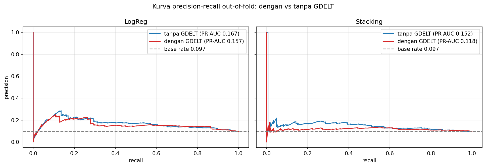
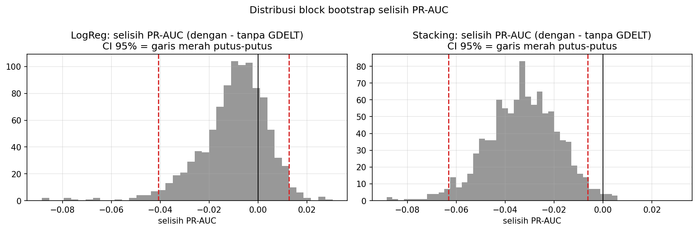
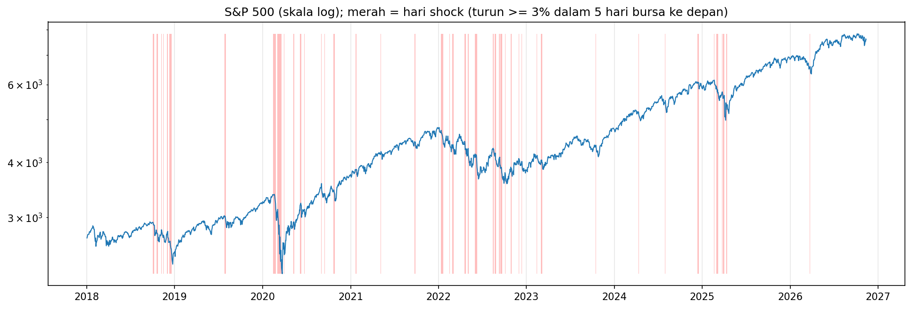

# geomacro-pulse


[](https://colab.research.google.com/github/arfan379/geomacro-pulse/blob/main/analysis/geomacro_lengkap.ipynb)

Pipeline data dan analisis untuk menguji apakah berita geopolitik (GDELT) membantu memprediksi *market shock* di pasar saham AS.

> **Temuan singkat:** pada data ini, GDELT **tidak** menambah kemampuan prediksi. Hasil negatif ini sah, bukan kegagalan.

**Daftar isi:**
[Tentang proyek](#tentang-proyek) ·
[Hasil](#hasil) ·
[Data](#data) ·
[Fitur utama](#fitur-utama) ·
[Tech stack](#tech-stack) ·
[Struktur repo](#struktur-repo) ·
[Instalasi dan menjalankan](#instalasi-dan-menjalankan) ·
[Asumsi dan batasan](#asumsi-dan-batasan) ·
[Kontribusi dan lisensi](#kontribusi-dan-lisensi)

---

## Tentang proyek

Guncangan pasar saham sulit diantisipasi, dan banyak yang menduga berita geopolitik (perang, sanksi, ketegangan) memberi tanda awal. Pertanyaan proyek ini: **apakah data berita dunia menambah kemampuan memprediksi guncangan, dibandingkan model yang hanya memakai data pasar dan makro?**

*Shock* didefinisikan sebagai S&P 500 turun ≥ 3% dari penutupan hari ini pada titik terendah dalam 5 hari bursa ke depan. Ada 242 hari shock (81 episode) dari 2.229 hari bursa. Pada data model, setelah baris awal dan hari tanpa GDELT dibuang, jumlahnya sedikit lebih kecil.

Repo ini berisi pipeline pengambilan data (`data_engineering/`) serta notebook analisis dan presentasi hasilnya (`analysis/`). Penggunanya analis atau peneliti data finansial yang ingin mereplikasi atau memperluas pengujian ini. Proyek ini riset pribadi.

```text
yfinance + FRED + GDELT  →  validasi  →  Google Drive  →  Colab
      (lokal, incremental)               (jembatan)       (analisis)
```

## Hasil

Pada data ini, GDELT tidak menambah kemampuan prediksi. Regresi logistik tanpa GDELT paling baik, dan menambah GDELT tidak memperbaiki apa pun. Pada model stacking, GDELT justru menurunkan performa.

| Model | PR-AUC | Brier |
|---|---|---|
| Tebakan acak (base rate) | 0,097 | 0,0878 |
| Regresi logistik tanpa GDELT | **0,167** | 0,0958 |
| Regresi logistik dengan GDELT | 0,157 | 0,0992 |
| Stacking tanpa GDELT | 0,152 | 0,0919 |
| Stacking dengan GDELT | 0,118 | 0,0927 |

Selisih dengan vs tanpa GDELT (block bootstrap, CI 95%):

- **Regresi logistik:** -0,010 [-0,041; +0,013], tidak beda dari nol.
- **Stacking:** -0,034 [-0,063; -0,006], GDELT menurunkan performa.

**Dua catatan membaca hasil:** semua model hanya sedikit di atas tebakan acak, dan skor Brier semuanya lebih buruk dari tebakan konstan. Artinya probabilitas yang dihasilkan belum bisa dipercaya sebagai angka peluang.







Presentasi lengkap: [`presentasi.pptx`](analysis/presentation/presentasi.pptx) (versi PDF: [`presentasi.pdf`](analysis/presentation/presentasi.pdf))

## Data

Semua data publik dan gratis, bukan simulasi.

| Data | Sumber | Isi | Periode |
|---|---|---|---|
| Harga pasar | Yahoo Finance (yfinance) | S&P 500, VIX, emas, minyak, indeks dolar | 2018 – Nov 2026 |
| Makro AS | FRED | Yield 10y dan 2y, CPI, fed funds | 2017 – Nov 2026 |
| Berita dunia | GDELT Project (events 1.0) | Jumlah event konflik, skor Goldstein, nada berita | 2018 – Nov 2026 |

Isi `data_engineering/data/raw/` (Parquet, kolom `date`):

| File | Isi |
|---|---|
| `market.parquet` | S&P 500, VIX, emas, minyak, DXY (`*_close`) dan `sp500_volume` |
| `fred.parquet` | `yield_10y`, `yield_2y`, `cpi`, `fed_funds` (tidak di-forward-fill) |
| `gdelt_daily.parquet` | `n_events`, `n_verbal_conflict`, `n_material_conflict`, `n_violent`, `n_protest`, `conflict_share`, `goldstein_mean/wmean`, `avgtone_mean/wmean`, `mentions_sum` |
| `validation_report.json` | temuan validasi dari run terakhir |

Konflik = QuadClass 3 (verbal) dan 4 (material), kekerasan = kode CAMEO 18–20, protes = kode 14. Versi `wmean` dibobot jumlah mention.

## Fitur utama

### Pipeline data (`data_engineering/`)

- **Incremental.** Hanya menarik tanggal yang belum ada. Pasar menarik ulang 7 hari terakhir, FRED 120 hari (data bulanan sering direvisi), dan hari GDELT yang gagal otomatis dicoba lagi.
- **Validasi dua tingkat.** ERROR (file hilang, tanggal duplikat, harga ≤ 0, data basi) membuat exit code 1. WARNING (celah tanggal, banyak null) hanya dicatat ke `validation_report.json`.
- **Sinkronisasi ke Drive tanpa duplikat.** File dicari berdasarkan nama lalu di-update, file yang isinya sama (cek MD5) tidak diunggah ulang, dan ada retry untuk error sementara.
- **Sync yang berhati-hati.** Upload dilewati kalau ada sumber gagal atau validasi menemukan ERROR, supaya data rusak tidak sampai ke Colab.
- **Data tetap mentah.** Alignment zona waktu, join, dan penanganan celah dikerjakan di notebook supaya prosesnya terdokumentasi.

Contoh log dari satu kali jalan:

```text
validate | [fred]  tanggal_bolong: cpi: 1 celah besar: 2025-09-01 -> 2025-11-01 (61 hari)
validate | [gdelt] tanggal_bolong: 11 kolom (...): 18 hari hilang -> ['2025-06-14 s/d 2025-07-01']
validate | Validasi selesai: 0 ERROR, 2 WARNING. Laporan: validation_report.json
gdrive   | Sync selesai ke 'My Drive/geomacro/raw': {'created': 4, 'updated': 0, 'skipped': 0}
```

### Analisis (`analysis/`)

- **Anti-bocor.** GDELT dipakai satu hari terlambat, data FRED hanya setelah tanggal tersedianya, dan ada uji otomatis yang menghentikan notebook kalau fitur memakai informasi masa depan.
- **Validasi berurutan.** 6 putaran walk-forward dengan jeda 10 hari. Model yang sama dibandingkan dengan dan tanpa GDELT pada baris yang sama, tanpa tuning.
- **Rezim pasar.** Gaussian Mixture Model, dilatih ulang di tiap putaran hanya dengan data latih.
- **Evaluasi jujur.** PR-AUC dan Brier dibandingkan dengan tebakan acak, selisihnya dinilai dengan block bootstrap, ditambah kalibrasi, SHAP out-of-fold, dan studi kasus krisis.

## Tech stack

- **Pipeline:** Python 3.10+, pandas, pyarrow, yfinance, fredapi, requests, tenacity, Google Drive API (OAuth), PyYAML, python-dotenv
- **Analisis (Colab):** scikit-learn (regresi logistik, random forest, GMM), LightGBM, CatBoost, SHAP, matplotlib

## Struktur repo

```text
geomacro-pulse/
├── README.md
├── LICENSE
├── data_engineering/             # pengambilan, validasi, dan sinkronisasi data
│   ├── src/                      # ingestion/, cloud/, validate.py, run_ingestion.py
│   ├── config/settings.yaml      # ticker, seri FRED, folder Drive
│   ├── data/raw/                 # parquet mentah (tidak di-commit)
│   └── requirements.txt
└── analysis/                     # analisis dan hasil
    ├── geomacro_lengkap.ipynb    # seluruh analisis (jalankan di Colab)
    ├── figures/                  # grafik hasil
    └── presentation/             # presentasi
```

File rahasia (`.env`, `client_secret.json`) berada di `data_engineering/` dan tidak di-commit.

## Instalasi dan menjalankan

### 1. Ambil data (lokal)

Semua perintah dijalankan dari dalam `data_engineering/`. Butuh `FRED_API_KEY` di `data_engineering/.env` (gratis di [fred.stlouisfed.org](https://fred.stlouisfed.org/), menu My Account → API Keys).

```bash
git clone https://github.com/arfan379/geomacro-pulse.git
cd geomacro-pulse
python3 -m venv .venv && source .venv/bin/activate
cd data_engineering
pip install -r requirements.txt
cp .env.example .env          # lalu isi FRED_API_KEY

python -m src.run_ingestion --start 2018-01-01      # tarik data + validasi
python -m src.validate                              # validasi saja
```

Menarik GDELT dari 2018 memakan waktu beberapa jam (satu file per hari), tapi bersifat incremental dan bisa dilanjutkan kalau terputus.

### 2. Sinkronisasi ke Google Drive (opsional, dibutuhkan untuk analisis di Colab)

1. Di Google Cloud Console, aktifkan Drive API dan buat OAuth client ID bertipe *Desktop app*. Simpan JSON-nya sebagai `data_engineering/client_secret.json`.
2. Login sekali: `python -m src.cloud.gdrive_sync --auth`
3. Upload: `python -m src.run_ingestion --sync`

Folder `geomacro/raw` dibuat otomatis di My Drive. Jangan biarkan consent screen berstatus *Testing*, karena refresh token kedaluwarsa dalam 7 hari.

### 3. Analisis (Colab)

[](https://colab.research.google.com/github/arfan379/geomacro-pulse/blob/main/analysis/geomacro_lengkap.ipynb)

Klik badge di atas (atau unggah `analysis/geomacro_lengkap.ipynb` ke Colab), pastikan data ada di `MyDrive/geomacro/raw/`, lalu **Runtime → Run all**. Grafik tersimpan otomatis di `MyDrive/geomacro/figures/`.

## Asumsi dan batasan

<details>
<summary><b>Data dan sinyal</b></summary>

- **GDELT dirangkum secara global**, tidak per negara atau topik. Detail geografis hilang, dan itu bisa menjadi alasan sinyalnya lemah.
- **Patahan level GDELT.** Volume event punya patahan sekitar Maret 2023 (naik kira-kira dua kali lipat) dan tren turun panjang sejak 2018. Fitur berbasis jumlah (`z_events`, `z_violent`) bisa menyesatkan di sekitar periode itu. Dampaknya pada hasil belum diuji.
- **Data hilang.** 24 hari kalender GDELT tidak terpakai (20 hari file tidak ada di server, 4 hari file parsial), dan CPI Oktober 2025 tidak tersedia.
- **Kualitas sumber.** Yahoo Finance diakses lewat pustaka tidak resmi, jadi ada validasi data basi. GDELT dikodekan mesin dari media dunia.

</details>

<details>
<summary><b>Evaluasi</b></summary>

- **COVID 2020 tidak masuk periode uji**, hanya data latih. Krisis terbesar di data tidak pernah diuji secara out-of-sample.
- **Episode krisis sedikit dan bergerombol**, sehingga interval kepercayaan lebar. CI hanya menangkap variasi sampel uji, bukan variasi pelatihan.
- **Perbandingan berganda.** Ada 4 perbandingan (2 model × 2 target). Satu interval yang sedikit di atas atau di bawah nol bukan bukti kuat.
- Uji ketahanan dengan ambang shock 4% ada di notebook.

</details>

<details>
<summary><b>Waktu dan kebocoran informasi</b></summary>

- **Tanggal GDELT adalah tanggal file (UTC)**, bukan tanggal kejadian, dan **data FRED dipakai setelah tanggal tersedianya**. Keduanya untuk mencegah kebocoran informasi dari masa depan.

</details>

<details>
<summary><b>Infrastruktur</b></summary>

- **OAuth user credentials dengan scope `drive.file`, bukan service account**, karena service account sering kena `storageQuotaExceeded` di My Drive pribadi. Konsekuensinya, folder tujuan dibuat oleh skrip, bukan manual.
- **Drive sebagai jembatan, bukan database.** Sederhana dan gratis, tapi tidak ada kontrol konkurensi: yang menulis terakhir menang.

</details>

## Kontribusi dan lisensi

Ini proyek riset pribadi yang masih bisa dikembangkan. Issue dan saran terbuka lewat tab [Issues](https://github.com/arfan379/geomacro-pulse/issues), dan pull request kecil (perbaikan bug, sumber data tambahan, fitur GDELT per negara atau topik) dipersilakan. Untuk perubahan besar, buka issue dulu supaya arahnya cocok.

Dirilis dengan lisensi [MIT](LICENSE). Untuk riset dan belajar, bukan nasihat investasi.